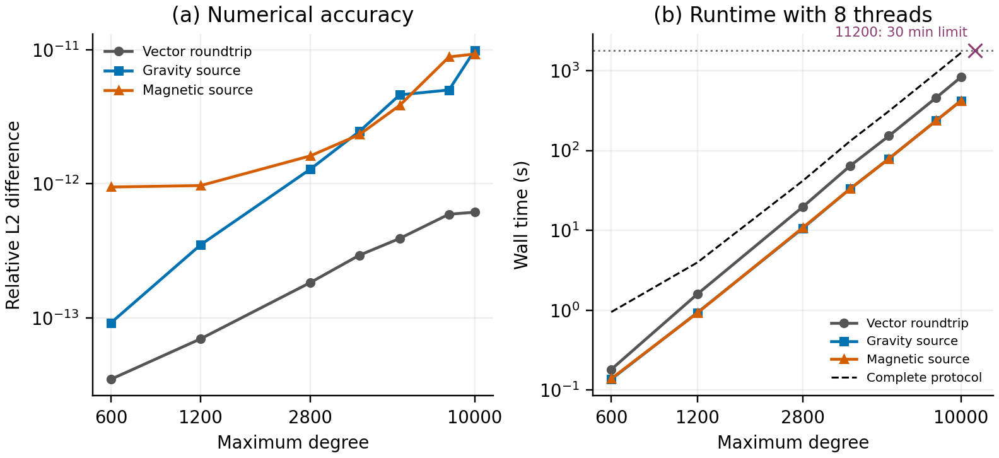

# Native high-degree validation

The current completed sweep reaches degree 10000. The full stopping record is in `limits.json` and `attempts.csv`.

Run from the GravMagSphere repository using the existing GravMagPy environment:

```sh
OMP_NUM_THREADS=8 MPLBACKEND=Agg /Users/danywaller/code/venvs/gravmagpy/bin/python diagnostics/native_high_degree.py
```

A single integer argument runs only that degree. With no argument, the script tries 600, 1200, 2800, 4096, 5600, 8192, 10000, 11200, 14000, 18000, and 22000, stopping at the first failed check or resource bound. The limit is 1800 wall seconds for the entire protocol at each degree, including both source-field modes. The estimated workspace ceiling is 32768 MiB. The implementation's default workspace limit is 16384 MiB. The validation explicitly raises it while leaving half of the machine's 64 GiB physical memory outside this estimate.

Each completed degree includes:

- Independent Jacobi-polynomial references at 80 and 160 decimal digits for six selected degree/order/colatitude combinations
- A full-bandwidth vector synthesis/analysis roundtrip with every coefficient populated, including both Fourier directions
- Public gravity and magnetic calculations compared with analytical point-mass and dipole fields at 25 observations

The test thresholds are 2e-9 for scaled individual function differences and maximum coefficient differences, 2e-10 for the relative coefficient norm, and 2e-9 for each relative source-field norm. Actual errors, not just threshold outcomes, are stored in `multiprecision.csv`, `results.csv`, and `summary.csv`. All values use Schmidt semi-normalization without the Condon–Shortley phase. Neither the implementation nor these references use SHTOOLS.

Method references include [Fukushima (2012), extended-exponent arithmetic](https://doi.org/10.1007/s00190-011-0519-2), [Sneeuw (1994), quadrature and least squares](https://doi.org/10.1111/j.1365-246X.1994.tb03995.x), and [Schaeffer (2013), spherical-harmonic transforms](https://doi.org/10.1002/ggge.20071). The manuscript gives the implemented recurrence, vector projection, and degree filter explicitly.

Each `degree_*` directory preserves source input cards, predictions, analytical reference arrays, diagnostic output, selected multiprecision values, and metadata. Completed runs record the compiled executable hash. Random coefficients use the seed 19102026 plus degree. Grids have degree+1 Gauss–Legendre latitudes and a power-of-two longitude count at least 2*degree+1. Coefficient arrays and global grids are regenerated to avoid multi-gigabyte archives.

`process_peak_mib` is the worker's lifetime peak RSS. `child_peak_mib` is its largest child-process peak. They are not a simultaneous process-tree sum. Reported timings are single executions, not repeated performance distributions. The native functions and transforms also have independent regression checks in `GravMagPy/tests/test_schmidt.py`. The source checksums in this directory identify the evaluated implementation. The manuscript package also contains the complete source snapshot.


